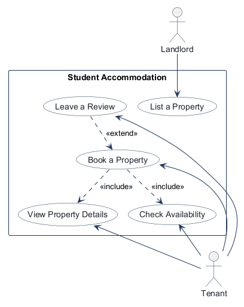
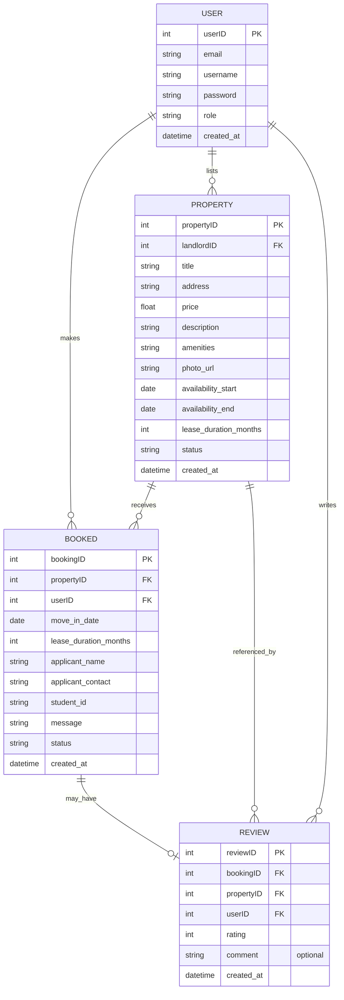
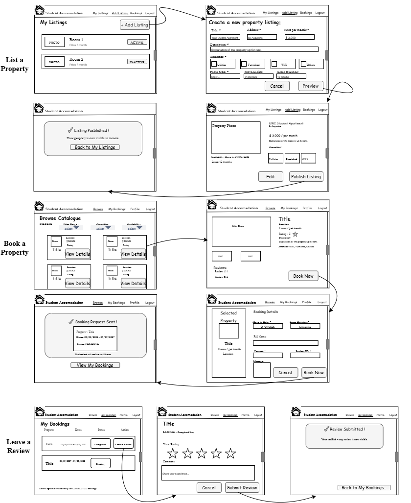

# COMP 3613 Assignment 1

Draft this file with the Guide. **Update it after every phase milestone** before you pause. The use-case diagram is a UML PNG at `docs/diagrams/use-case.png`, linked from this file as `diagrams/use-case.png` (path relative to `docs/report.md`). The model diagram is Mermaid. **Embed wireframe images** as `wireframes/<file>` (files live in `docs/wireframes/`).

Do not put your student ID in this file if you will commit it. The PDF cover adds your name and ID at export time.

## Assigned project

Student Accommodation

## Three workflows

### 1.

List a Property (Landlord)

### 2.

Book a Property (Tenant)

### 3.

Leave a Review (Tenant)

## Use case diagram

The booking flow includes viewing a property and checking availability before booking, and the review workflow is treated as an extension of a completed booking rather than a separate top-level actor flow.

## Model diagram

Phase 4 revision: `Booked` captures the booking-form details and lifecycle shown in the wireframe. `Review` remains a separate, optional record.

Relationship and rule notes: one landlord lists many properties, and each property has one landlord; a tenant can make many bookings, each for one property; a property can have multiple bookings over time. A booking records the requested move-in date, lease duration, applicant details, message, and status (`Pending`, `Confirmed`, `Rejected`, or `Completed`). Book a Property is complete when the tenant sends the request. For Leave a Review, the student chose to auto-complete an approved booking after its lease end date, when My Bookings next loads. A booking may have zero or one review, and each review belongs to one booking; the wireframe offers review submission for completed bookings. `Review.propertyID` and `Review.userID` repeat links available through `bookingID`; they must agree with that booking. Multiple pending requests may exist before approval; approving one rejects the others and advances listing availability to prevent a conflicting accepted lease.

Phase 5 listing decision: clicking **Publish Listing** after preview makes the listing `Active` immediately.

Implementation mapping: the ERD names the landlord key `USER.userID`; the existing FastStarter user table maps this to SQLModel field `User.id` (`user.id` in the database), so `Property.landlordID` references that existing primary key without renaming the starter auth field.

## Wireframes

### Student Accommodation workflows

<!-- student-build:wireframe-coverage
use_case: List a Property
image: docs/wireframes/wireframes.drawio.png
covered: yes
-->

<!-- student-build:wireframe-coverage
use_case: View Property Details
image: docs/wireframes/wireframes.drawio.png
covered: yes
-->

<!-- student-build:wireframe-coverage
use_case: Check Availability
image: docs/wireframes/wireframes.drawio.png
covered: yes
-->

<!-- student-build:wireframe-coverage
use_case: Book a Property
image: docs/wireframes/wireframes.drawio.png
covered: yes
-->

<!-- student-build:wireframe-coverage
use_case: Leave a Review
image: docs/wireframes/wireframes.drawio.png
covered: yes
-->

`python manage.py report` also embeds any PNG/JPG still missing from `docs/wireframes/`.

## Theming

Brand: **Student Accommodation**. The taskbar and auth screens use an original house mark with a graduation-cap roof detail; the supplied logo is inspiration only. The look is modern, warm, friendly, and trustworthy.

- Colors: warm off-white `#FAFAF9` background, white surfaces, stone borders/text, and deep navy `#1E3A5F` for navigation and standard actions. Reserve amber `#C97B3F` for **Book Now** on property details, **Publish Listing** on the listing preview, and **Submit Review** on the review form; use dark text on amber for legibility. Status colors follow the wireframe-specific palette.
- Type: Poppins 600/700 for headings, Inter 400/500 for body and controls, and JetBrains Mono for booking references.
- Tone: approachable, plain-language copy with calm, warm confirmations and helpful errors.
- Components: white taskbar with subtle border, 12px cards, rounded inputs with a navy focus ring, restrained shadows, and top-right toasts.
- Applied to the public landing, login, registration, and authenticated shell. The generic admin starter page was removed; the password-gated `/config` panel remains.

<!-- student-judge:sincerity
round: 1
questions_asked: 2
flags: polished branding brief and conflicting app/wordmark name
sincerity_confidence: 0.55
trend: flat
note: Follow-up choices clarified the displayed name and that the supplied logo should only inspire an original mark.
-->

<!-- student-judge:sincerity
round: 2
questions_asked: 4
flags: initial branding brief was highly polished
sincerity_confidence: 0.80
trend: up
note: Student explained color intent, original-mark direction, and selected the graduation-cap roof detail in their own words.
-->

## Implementation notes

One named workflow at a time. Include verify notes and polish / model revisions (Phase 5). Do not treat the first build as final.

Theme verification: the student reported that the landing and auth screens look good. They requested role-specific taskbar links (tenant/student: Browse, My Bookings; landlord: My Listings, Add Listing, Bookings) and a direct Logout link. Profile was removed from the navigation because it is not a named workflow and has no designed screen.

Phase 5 account setup: registration offers **Student / Tenant** (stored as `tenant`) or **Landlord** (stored as `landlord`). The authenticated bar displays the selected role and a direct Logout link. Browse, My Bookings, My Listings, Add Listing, and landlord Bookings are wired.

Role-selection verification: the student confirmed that the two account types and direct Logout behavior match the intended design.

Skips: 1/3 used
- Property SQLModel snippet — assumed: Property uses the ERD fields; verified against the student's second attempt.

<!-- student-build:code-check
workflow: List a Property
form: choice
layer: other
architecture_ok: yes
implement_confidence: 0.62
passed: yes
note: Chose to make a listing Active immediately after Publish Listing.
-->

<!-- student-build:code-check
workflow: List a Property
form: mcq
layer: router
architecture_ok: no
implement_confidence: 0.52
passed: no
note: Chose Router to coordinate whether incomplete listings can publish; Service owns this decision.
-->

<!-- student-build:code-check
workflow: List a Property
form: snippet
layer: model
architecture_ok: yes
implement_confidence: 0.38
passed: yes
note: Property fields match the ERD; landlordID targets the existing User.id column.
-->

<!-- student-build:code-check
workflow: List a Property
form: snippet
layer: service
architecture_ok: yes
implement_confidence: 0.35
passed: yes
note: Enforces landlord role, maps ownership to User.id, marks listings active, and calls the repository; Guide corrected indentation after the student attempt.
-->

<!-- student-build:code-check
workflow: List a Property
form: snippet
layer: router
architecture_ok: yes
implement_confidence: 0.38
passed: yes
note: Builds PropertyCreate, constructs repository/service, calls service, and redirects without persistence logic in the router.
-->

<!-- student-build:code-check
workflow: List a Property
form: mcq
layer: service
architecture_ok: yes
implement_confidence: 0.40
passed: yes
note: Correctly identified the Service as owning the initial Active-status decision.
-->

List a Property implementation: added the ERD-backed Property model and landlord FK, repository create/read methods, service role and date/price validation, and landlord-only My Listings → Add Listing → Preview → Publish → confirmation flow. Landlord registration now lands on My Listings. The landlord taskbar routes My Listings, Add Listing, and Bookings; tenant Browse and My Bookings are wired.

List a Property verification: the student tested Add Listing, Preview, Publish Listing, and Edit Details and reported that all work. They confirmed the newly published property appears with an ACTIVE badge and that the workflow looks good against the wireframe; no polish changes were requested.

<!-- student-build:code-check
workflow: List a Property
form: open
layer: other
architecture_ok: yes
implement_confidence: 0.45
passed: yes
note: Student verified Add Listing, Preview, Edit Details, Publish, ACTIVE status, and wireframe appearance.
-->

Book a Property decision: overlapping Pending requests for the same property are allowed so landlords can review multiple requests; each submitted booking starts as `Pending`.
Availability rule (revised during Phase 5 polish): the entire lease must fit within the listing's availability period. Pending requests may coexist; once a landlord approves one, the listing's earliest availability advances to the day after that lease ends. The student specified that a listing remains Active and visible in Browse even when no dates remain in its current window; the UI indicates that no booking dates are currently available.

<!-- student-build:code-check
workflow: Book a Property
form: choice
layer: other
architecture_ok: yes
implement_confidence: 0.62
passed: yes
note: Chose to allow multiple overlapping Pending requests for landlord review.
-->

<!-- student-build:code-check
workflow: Book a Property
form: mcq
layer: service
architecture_ok: yes
implement_confidence: 0.62
passed: yes
note: Correctly identified the Service as coordinating date/availability decisions.
-->

<!-- student-build:code-check
workflow: Book a Property
form: snippet
layer: model
architecture_ok: yes
implement_confidence: 0.62
passed: yes
note: Added the Booked ERD fields and FK targets; Guide aligned default status casing to Pending.
-->

<!-- student-build:code-check
workflow: Book a Property
form: snippet
layer: repository
architecture_ok: yes
implement_confidence: 0.58
passed: yes
note: BookingRepository.create adds, commits, refreshes, and returns the new Booked row.
-->

<!-- student-build:code-check
workflow: Book a Property
form: snippet
layer: service
architecture_ok: partial
implement_confidence: 0.48
passed: partial
note: Enforces tenant role and move-in window and calls the repository; Guide added PropertyRepository.get, active-listing/lease/ID checks, and Pending casing alignment.
-->

<!-- student-build:code-check
workflow: Book a Property
form: snippet
layer: router
architecture_ok: yes
implement_confidence: 0.40
passed: yes
note: Builds BookingCreate, constructs repositories/service, calls service, and redirects with the returned booking ID; no SQL in route.
-->

Book a Property implementation: added active catalogue search (price bounds, selected amenities, and move-in date), active property details, request form, Pending booking creation, confirmation with reference, and My Bookings. Tenant-only endpoints and repository/service layers enforce account role, active listing, full-lease availability range, positive lease duration, and ownership when showing a tenant's booking. Booking summary entries include their property title. Multiple Pending requests remain possible until landlord approval; approval advances the listing's earliest availability and rejects competing Pending requests.

<!-- student-build:code-check
workflow: Book a Property
form: open
layer: other
architecture_ok: yes
implement_confidence: 0.40
passed: partial
note: Student's service attempt checked tenant role and move-in range; surrounding service validation and booking UI are integrated, pending user verification.
-->

Book a Property verification: the student confirmed that submitting with the message left blank now reaches the confirmation page. After the catalogue route was updated to treat blank optional values as unset, explicitly validate nonblank values, and bind amenities as a GET query list, the student said they believe the filters are now working correctly; individual filter-result details were not reported.

<!-- student-build:code-check
workflow: Book a Property
form: choice
layer: service
architecture_ok: yes
implement_confidence: 0.58
passed: yes
note: Chose to validate move-in date only; lease may extend beyond listing availability end.
-->

Login fix: the handler now names the repository result `authenticated_user` and uses that same variable when selecting the post-login destination. The earlier version referenced `user.role` before assigning the variable; Pylance reported `reportUndefinedVariable`.

Login verification: the student restarted the app and confirmed landlord sign-in succeeds. The listing workflow remains unverified.

<!-- student-build:code-check
workflow: List a Property
form: snippet
layer: repository
architecture_ok: yes
implement_confidence: 0.38
passed: yes
note: Repository create method adds, commits, refreshes, and returns the Property record.
-->

Booking polish: the optional message field now defaults to empty; blank optional catalogue price/date values are treated as unset, while malformed nonblank values return a clear validation error. Amenities are bound as repeated query parameters. Student confirmed the booking confirmation page works and believes the filters are working correctly.

Leave a Review decisions: a tenant may review only a completed booking. After the student reported there was no review option, they chose landlord approval/rejection as supporting behavior for the existing named workflows, not as a new workflow. Approval changes a Pending request to Confirmed and rejects other Pending requests for that property; rejection changes the selected request to Rejected. Confirmed bookings become Completed automatically after the lease end date, checked when My Bookings loads. A pending booking is rejected by the Service, not the Router.
Lease completion date: the booking auto-completes on the matching calendar day after its lease duration (for example, January 15 plus 12 months completes on January 15 the following year).

<!-- student-build:code-check
workflow: Leave a Review
form: snippet
layer: model
architecture_ok: yes
implement_confidence: 0.62
passed: yes
note: Review model fields match the ERD, including booking/property/user foreign keys, rating, optional comment, and created_at.
-->

<!-- student-build:code-check
workflow: Leave a Review
form: snippet
layer: router
architecture_ok: yes
implement_confidence: 0.62
passed: yes
note: Thin POST handler binds rating/comment and delegates to a service; Guide aligned the service method name and My Bookings redirect.
-->

<!-- student-build:code-check
workflow: Leave a Review
form: snippet
layer: repository
architecture_ok: yes
implement_confidence: 0.62
passed: yes
note: ReviewRepository filters by booking ID and persists with add/commit/refresh.
-->

<!-- student-build:code-check
workflow: Leave a Review
form: snippet
layer: service
architecture_ok: yes
implement_confidence: 0.58
passed: partial
note: Student implemented ownership, completed-status, duplicate-review, and 1–5 rating checks; Guide aligned the booking lookup with the repository API and made status casing tolerant.
-->

Leave a Review implementation: registered the Review table; enforced one review per booking; added review eligibility and duplicate/rating validation in the service, review persistence in the repository, a completed-booking-only action in My Bookings, the rating/comment form, and the submission confirmation page. My Bookings now marks a Confirmed booking Completed once the matching-day lease end date has arrived. Landlord approval/rejection is available from the landlord Bookings page.

Approval and review verification: the student confirmed landlord approval/rejection and review submission reach their expected pages. They also confirmed the submitted review appears on the property page and requested that it sit below the image; its placement was updated. The student reported that the star control was reversed (fourth star submitted rating 2); after the values were rendered left-to-right from 1 to 5, the student confirmed the rating works correctly. The student confirmed availability advancement works and requested that listings remain visible after the current date window is exhausted. The listing remains Active; the student observed Book Now still visible in their case and asked to keep the implementation simple rather than continue that UI refinement. Server-side booking validation still requires the full lease to fit within the current window. The student reported that the three named workflows are working.

<!-- student-build:code-check
workflow: Leave a Review
form: choice
layer: other
architecture_ok: yes
implement_confidence: 0.62
passed: yes
note: Chose automatic lease-end completion, with optional landlord early completion deferred to preserve current wireframe scope.
-->

<!-- student-build:code-check
workflow: Leave a Review
form: mcq
layer: service
architecture_ok: yes
implement_confidence: 0.62
passed: yes
note: Correctly assigned rejection for a Pending booking to the Service.
-->

<!-- student-build:code-check
workflow: Leave a Review
form: choice
layer: service
architecture_ok: yes
implement_confidence: 0.62
passed: yes
note: Selected My Bookings page load as the point to check whether lease end dates have passed.
-->

## Deployed app

Phase 6. Public Render URL (not localhost). Markers open this to mark the three workflows.

https://

The service still needs to be deployed and this URL replaced with its verified public Render URL.

## Logins

Every account a marker needs, including extra users you added. Starter accounts:

- bob / bobpass — regular user (tenant flow)
- admin / adminpass — admin
- demo-landlord / landlordpass — demo landlord; owns six automatically seeded St. Augustine-area listings
- Register as a new tenant or landlord in the app if a marker needs a fresh role-specific account.

In production, app startup creates these marker accounts if their usernames are missing, then ensures the six demo listings exist. Existing accounts are not overwritten.

## YouTube URL

## Session transcripts

Filled when the Guide builds the report: the agent writes each Guide chat to `docs/transcripts/<slug>.md` (Copilot Agent, Cursor, or OpenCode). `python manage.py report` packages them. Do not paste chats here during the build.

## Competency (student-judge)

Filled when the report is built. Guide runs student-judge, writes `docs/judge.md`, and export appends the scorecard here.

## Skill integrity

Filled by `python manage.py report`. Do not edit the course skills.
